# Tango Cards 単語カード

Japanese–English flashcards made from photos of your vocab. Take a picture of a word list,
textbook page or handwritten notes, check the cards it found, and study them in sets from
either side with a card you flip and swipe.

- **Cards from photos.** An AI model reads each photo and makes the cards. You can also tell
  it what to make ("cards for the particles に, を and へ, with an example each").
- **Words and grammar.** Every card is either a *word* to memorize or a *grammar* rule
  (particles, conjugations, patterns). New cards are labeled automatically, and one tap moves
  a card to the other group.
- **Two ways to study a set.** *Smart learn* keeps a small rotation of cards until each one is
  cleared. *Review all* is one pass through the set. Both pick up where you stopped, and can
  be limited to words or grammar.
- **Practice across sets.** Random cards from any sets you choose, words, grammar or both.
- **Find cards.** Ask for a topic ("days of the week", "food and drinks", "particles for
  places") and a language model picks the matching cards from every set. Refine it ("only the
  verbs"), untick anything you don't want, then practice exactly those. With no model running
  it does a word search instead: type a word in English or Japanese (week, ねこ, 学校) and it
  finds the cards that contain it.
- **Hear it.** Tap 🔊 on a card, or in a set's card list, to hear the Japanese; tap again
  right away for slow. Turn on *Read aloud* while studying and each card speaks as its Japanese
  side appears. It uses your device's own Japanese voice (free, no setup): it says the reading
  when the card has one, so 家 comes out いえ or うち as written, and the particles は and へ
  sound like わ and え.
- Photos stay with their set, and every card links back to the photo it came from.
- Works on phones: swipe right for "got it", left for "again".

## See it

<p align="center">
  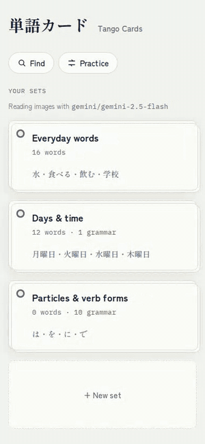
  <br>
  <sub>A one-minute tour, sped up. <a href="docs/media/demo.mp4">Watch it full speed (MP4)</a>.</sub>
</p>

The tour opens a set and studies it: flip, swipe right for "got it", swipe left for "again".
It then makes cards from [a page of notes](docs/media/sample-notes.jpg): Gemini reads all
eight items and labels the two patterns (〜が好きです, 〜がきらいです) as grammar on its own.
Last, it finds the days of the week across sets and practices only grammar.

| Your sets | A set | Studying |
|:---:|:---:|:---:|
| 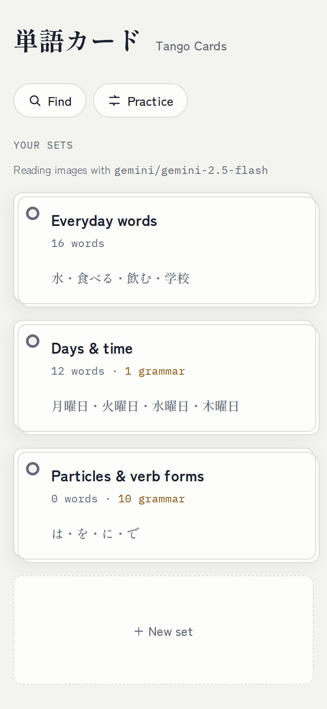 | 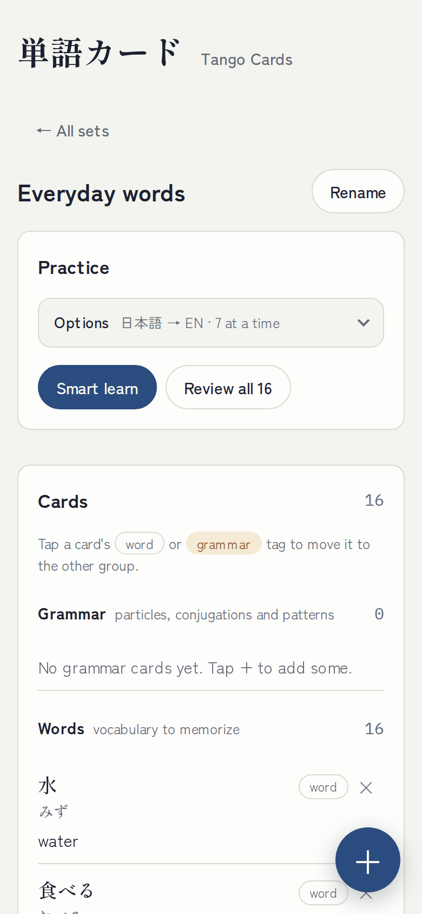 | 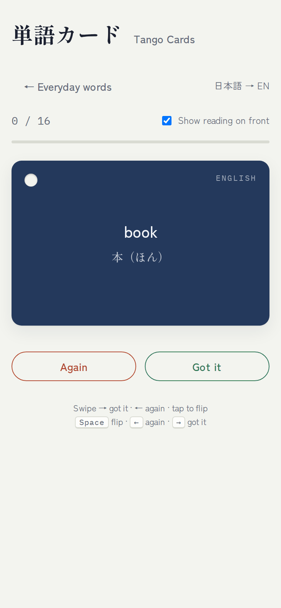 |
| **Swipe to answer** | **Add cards from a photo** | **Check what it found** |
| 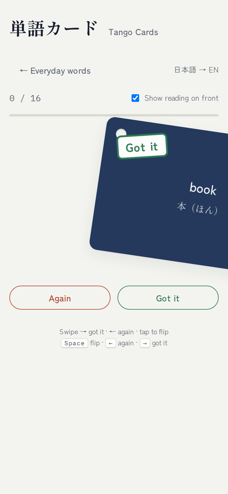 | 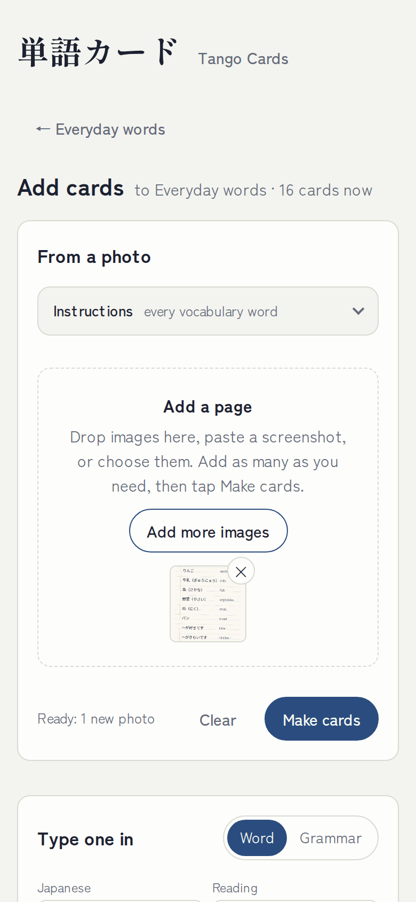 | 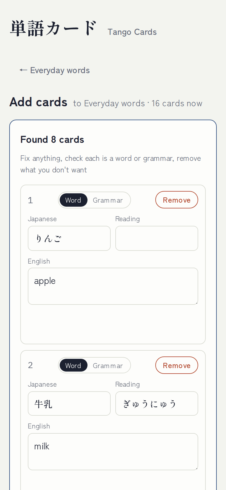 |
| **Words and grammar** | **Find cards** | **Practice across sets** |
| 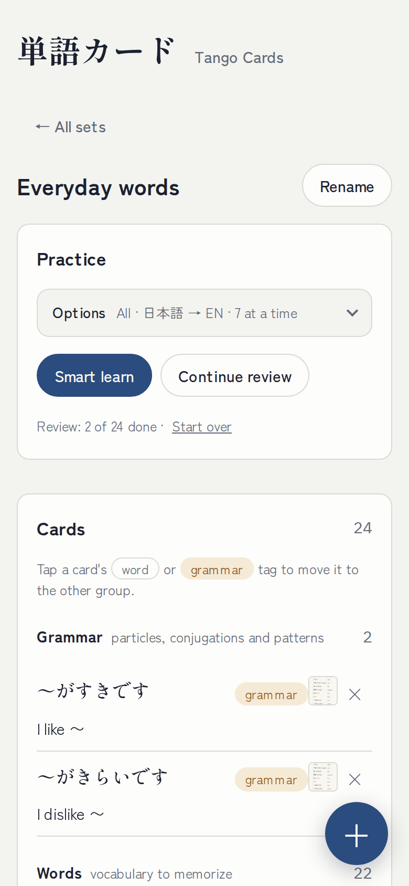 | 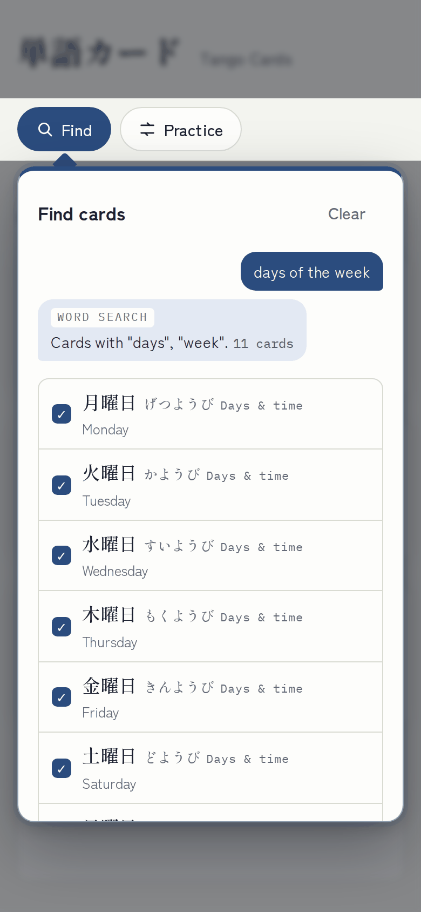 | 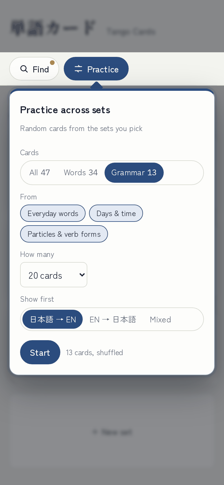 |
| **Dark mode** | | |
| 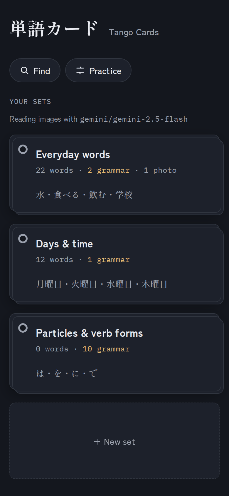 | 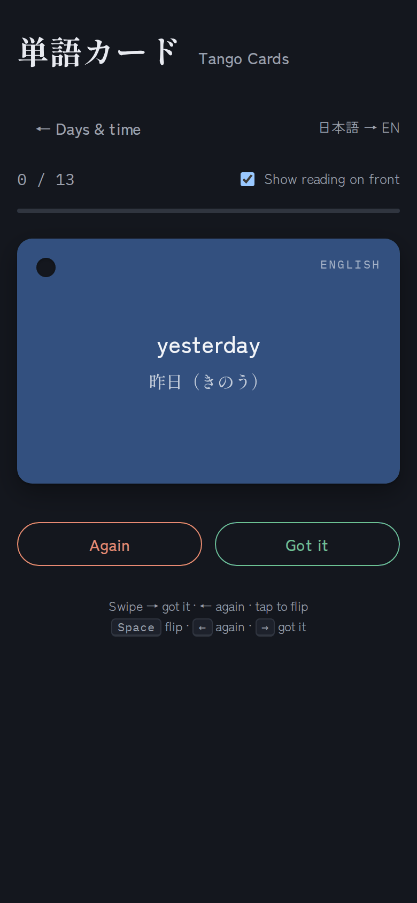 | |

<sub>Screenshots use a sample library. Find cards is shown doing its word search (no AI model running).</sub>

## What you need

| | What | Why |
|---|---|---|
| **Required** | [uv](https://docs.astral.sh/uv/) | Runs the app. It downloads Python (3.11 or newer) and every package by itself on the first start. |
| **Required** for photos | A **Gemini API key** (free to start) | **Gemini 2.5 Flash** reads your photos and turns them into cards. It reads the Japanese and the furigana, writes the English, and labels each card a word or a grammar rule. |
| Optional | An AI chat model for **Find cards** | Lets you ask for cards by topic ("food and drinks"). Without one, Find cards does a plain word search. See [Find cards](#find-cards) below. |
| Optional | [Node.js](https://nodejs.org/) 20.19+ or 22.12+ | Only to change the page's code. The built page is already in the repo. |

### Getting a Gemini API key

1. Go to [Google AI Studio → API keys](https://aistudio.google.com/apikey) and sign in with a
   Google account.
2. Click **Create API key**. If it asks, pick or create a Google Cloud project; the default is fine.
3. Copy the key (it starts with `AIza`) and paste it into `.env` after `GEMINI_API_KEY=`.
   The start script creates `.env` for you on its first run. See [Run it](#run-it).

Things to know:

- **Cost:** Gemini has a free tier, and reading a page of notes uses very little of it. Heavy
  use, or a project with billing turned on, can cost money. Check Google's
  [pricing page](https://ai.google.dev/gemini-api/docs/pricing).
- **Privacy:** on the free tier, Google may use what you send (your photos) to improve its
  products. Turn on billing for the project if that matters to you.
- **Keep the key private.** `.env` is in `.gitignore`, so it is never committed. Don't paste
  the key anywhere else.
- **Without a key** the app still runs. You can study, type cards in by hand, and search them;
  only *Make cards* from a photo fails, with a message that the key is missing.
- **Another provider** works too (OpenAI, Anthropic, or a local Ollama model). Change `MODEL`
  and set that provider's key. See [Settings](#settings-env).

## Run it

The only thing to install is [uv](https://docs.astral.sh/uv/). It fetches the right Python
and every package on the first start.

1. Install uv:
   - **macOS / Linux:** `curl -LsSf https://astral.sh/uv/install.sh | sh`
   - **Windows (PowerShell):** `powershell -ExecutionPolicy ByPass -c "irm https://astral.sh/uv/install.ps1 | iex"`
2. Get the code: `git clone https://github.com/nardoguy14/tango-cards.git`, or download it as a ZIP
   from the repo page (Code → Download ZIP) and unzip it.
3. Run the start script in the folder: `./start.sh` on macOS/Linux, or double-click
   `start.bat` on Windows. The first run creates `.env` and stops. Open `.env`, paste your
   Gemini API key after `GEMINI_API_KEY=`, save, and run the start script again.
4. Open http://localhost:8000. A phone on the same Wi-Fi can use
   `http://<this computer's IP>:8000`.

To use a different port: `PORT=8080 ./start.sh` (macOS/Linux), or `set PORT=8080` and then
`start.bat` (Windows). By hand:

```bash
cp .env.example .env        # then fill it in
uv run uvicorn app.main:app --host 0.0.0.0 --port 8000
```

## Settings (`.env`)

| Variable | What it does |
|---|---|
| `MODEL` | The model that reads photos, in LiteLLM's `provider/model` form. Default `gemini/gemini-2.5-flash`. |
| `GEMINI_API_KEY` (or `OPENAI_API_KEY`, `ANTHROPIC_API_KEY`, `OLLAMA_API_BASE`) | The key for that provider. |
| `DB_PATH`, `IMAGES_DIR` | Where sets and photos are stored. Default `data/`. |
| `HELPER_API_BASE` | Any OpenAI-compatible server for **Find cards**. Default `http://127.0.0.1:9200/v1` (a local vLLM). |
| `HELPER_MODEL` | The model name on that server. Default `qwen3.8-27b`. |
| `HELPER_API_KEY` | The key for that server, if it needs one. |

Photo reading works with any vision model LiteLLM supports:

| Provider  | `MODEL` example                | Key variable        |
|-----------|--------------------------------|---------------------|
| Gemini    | `gemini/gemini-2.5-flash`      | `GEMINI_API_KEY`    |
| OpenAI    | `openai/gpt-4.1-mini`          | `OPENAI_API_KEY`    |
| Anthropic | `anthropic/claude-sonnet-5-5`  | `ANTHROPIC_API_KEY` |
| Ollama    | `ollama_chat/qwen2.5vl`        | `OLLAMA_API_BASE`   |

### Find cards

**Find cards** works best with a chat model that can return JSON. Without one it falls back
to a word search (`app/search.py`): it matches what you type against each card's Japanese
(katakana and hiragana count as the same), reading and English, and the words *grammar*,
*verbs* and *words* narrow the results. A local model with vLLM:

```bash
vllm serve nvidia/Qwen3.8-27B-NVFP4 --served-model-name qwen3.8-27b --port 9200 --max-model-len 65536
```

A hosted API works too. For example, with OpenAI set `HELPER_API_BASE=https://api.openai.com/v1`,
`HELPER_MODEL=gpt-4.1-mini` and `HELPER_API_KEY=<your key>`.

## Your data

Sets, study progress and photos live in `data/`: `data/tango.db` (SQLite) and
`data/images/<set id>/`. They are **not** in git (see `.gitignore`). Back up `data/` to
keep them, and copy it to move them to another computer.

## Sharing it

There is no login. Anyone who can open the page can see and change every set, and their
photos and searches spend your model credits. Keep it on your own network, or share a
tunnel link (ngrok, Cloudflare) only with people you trust.

## How it fits together

The backend is FastAPI (Python). The page is a Vue 3 + TypeScript app built with Vite. The
built page is committed in `app/web/`, so running the app only needs uv. You need Node only
to change the front end.

```
app/                        backend
  main.py                   creates the app, wires the routes, serves the built page
  routes/
    sets.py                 sets, their cards, study progress
    photos.py               the photos each set was made from
    extract.py              photos -> cards (saves the photos, then the vision model reads them)
    find.py                 Find cards
  schemas.py                request bodies
  agent.py                  reads photos: Google ADK agent + LiteLLM model -> cards (word or grammar)
  finder.py                 asks an OpenAI-compatible model which cards match a request
  search.py                 the word search Find cards uses when no model is running
  db.py                     SQLite for sets and photo records; photo files on disk
  web/                      the built page (generated: don't edit)

frontend/                   the page's source
  src/
    main.ts, App.vue        start-up, and which screen is showing
    store.ts                sets, screens and navigation (the phone's back button works), saving
    study.ts                study rounds: Review all, Smart learn, practice across sets
    finder.ts               the Find cards conversation
    prefs.ts                choices remembered on this device
    api.ts, types.ts        the API and its shapes
    lib/                    cards, progress, photo and speech helpers
    composables/useSwipe.ts swiping a flashcard
    components/
      library/              home: Find cards, Practice across sets, your sets
      set/                  one set: practice, its cards, its photos, the round + button
      add/                  the add-cards screen: from photos, review what was found, type one in
      study/                the flashcard, its faces, the end of a round
      ui/                   the Options drawer and segmented buttons
    styles/                 tokens (colours, light and dark), then one file per area, and motion
```

### Changing the front end

```bash
cd frontend
npm install
npm run dev      # http://localhost:5173, live reload; /api goes to the server on :8000
npm run build    # type-checks, then writes app/web/ (commit it)
```

Set `API_TARGET=http://127.0.0.1:8090` before `npm run dev` if your server runs on another port.

| Method | Path | Body / result |
|---|---|---|
| GET | `/api/health` | `{ok, model, helper, helper_up}` |
| GET | `/api/sets` | every set with its cards and progress |
| POST | `/api/sets` | `{name, cards?}` → new set |
| PUT | `/api/sets/{id}` | `{name, cards}` → updated set. A card is `{id, jp, reading, en, kind: "word" or "grammar", image_id?}` |
| PUT | `/api/sets/{id}/progress` | where you stopped studying (JSON) → 204 |
| DELETE | `/api/sets/{id}` | 204, with its photos |
| GET | `/api/sets/{id}/images` | photos saved for a set |
| GET / DELETE | `/api/images/{id}` | a photo file / remove it |
| POST | `/api/extract` | multipart `set_id`, `files` (≤12 images, ≤10 MB each), optional `instructions` and `image_ids` → `{cards, images, errors}` |
| POST | `/api/find` | `{turns: [{role, text, ids?}], set_ids?}` → `{reply, cards, mode: "ai" or "simple"}` |

`/api/extract` saves every photo to the set first, then reads them (4 at a time), so a photo
that fails to read is still kept. The page shrinks photos to 2000 px on the long side before
upload.

## Limits

- One shared library: no accounts, and everyone shares the same sets and progress.
- SQLite and local files suit one small server. For more, move photos to object storage and
  sets to Postgres; only `app/db.py` needs to change.
